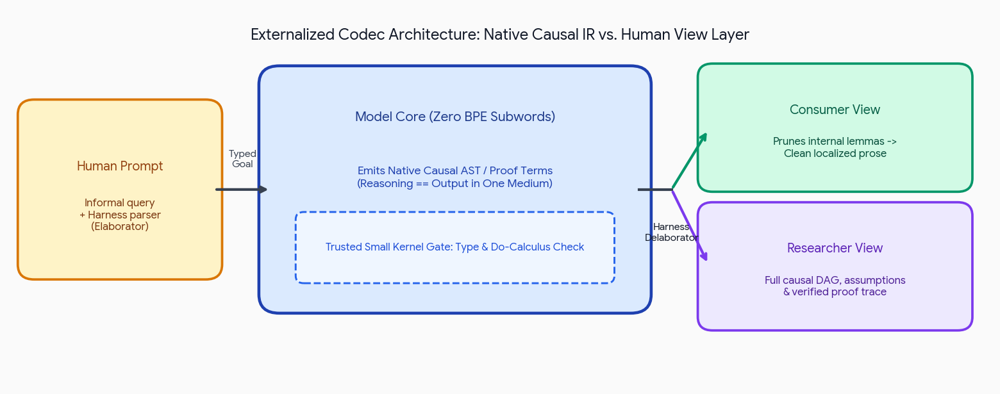

# Design Note: An Externally-Typed Causal IR with a Harness Delaborator

Date: 2026-11-14
Phase: Horizon 0 / Horizon I bridge research. Not adopted. Not an abios change by this note.
Related: `docs/design-notes/horizon-ii-ideas-backlog.md`, `docs/design-notes/horizon-ii-silicon-tinker-sandbox.md`, `docs/program/decomposition.md` (C3, C6), I2, Horizon 0.
Source material: a pasted external session turn plus one attached figure. The figure is included by explicit owner request. It is not a project deliverable. Reference links in the source are unchecked arXiv identifiers and are labeled as unverified.

## 1. The idea, in one line

Train the model to emit a typed causal term calculus as its only native medium, and move human-language rendering
entirely outside the model into a deterministic harness compiler. The "tokenizer" becomes a script, not a
subword-BPE vocabulary. Reasoning and output become one derivation stream, seen two ways.

Figure: session-generated diagram attached in the owner's 2026-11-14 session turn and included at explicit owner
request on 2026-11-14. Provenance: drawn by the responding assistant in that session. Not a project deliverable,
not a third-party asset, no external stock. License status is not established. It is committed for internal design
docs only. Do not reuse externally without an owner ruling. The depicted design is the pitch, not a shipped
architecture. Source turns contain no personal names, and the image does not either.

## 2. What is true and reusable

- Interactive provers (Lean 4) really do separate a small trusted kernel from an outside, rule-based surface layer.
  The delaborator is deterministic and render-only. Your model-architecture analogy is legitimate.
- Unfaithful Chain-of-Thought is a documented phenomenon: models routinely write plausible reasoning that does not
  match the actual inference. Moving rendering outside the model does make the explanation structurally incapable of
  misrepresenting the artifact it renders. It cannot make the explanation complete, and it cannot record discarded
  search branches. "Structurally incapable of lying" is the narrow, legitimate form of the claim and no wider.
- Autoformalization is the real bottleneck. Human input is underspecified. The honest pattern is: small
  translator proposes a typed query, delaborates it back plain, and a user or type checker confirms before the core
  runs. This matches how proof assistants teach beginners.
- Round-trip cycle consistency is a real training signal. Filtering transpiled traces by kernel pass plus round-trip
  fidelity is the only known way to manufacture corpus in a new IR.
- Pearl do-calculus is real. DoVerifier is claimed in the source but unverified against primary reading.

## 3. What is overstated

1. "Hallucinated logic becomes a type error." **Only within the closed world the calculus can express.** The kernel
   catches inconsistent steps. It does not catch valid proofs of the wrong theorem, mis-specified premises, or
   steps whose empirical priors were asserted with the wrong confidence.
2. "Impossible for the explanation to lie." **Narrower than claimed.** The delaborator faithfully renders the
   emitted AST. Nothing obliges the model to emit an AST that captures its whole process. Search, discarded branches
   and rejected proofs vanish unless the calculus commits to recording them. The honest claim: the explanation
   cannot misrepresent the artifact. It is silent about what is not in the artifact.
3. "One continuous derivation tree." **Philosophically true, operationally unsupported.** No corpus in this IR
   exists. The bootstrap is thousands of transpiled hours on frontier models plus solver filtering, and that cost is
   not paid here.
4. "Upgrading abios into a causal IR completes Horizon 0." **Scope confusion.** An IR is a language design program
   (syntax, typing, kernel, elaborator, delaborator, conformance vectors, corpus). Horizon 0 is the project layer
   that would use it. The two are not interchangeable, and nothing in this note makes abios change.
5. "Causal IR = constrained decoding = proof of safety." **Conflated categories.** Constrained grammar delivery is a
   decoder mechanism. Proof-checking is a kernel mechanism. Governance is a review mechanism. Each stands alone and
   the note must not mix them in public text.

## 4. The open design decisions, before anything is built

1. **Proving ground.** Two candidates offered in the source. This note recommends **state-transition planning**
   (verifiable grid/constraint worlds, program state mutations) first: decidable state checks, exact reference
   implementations, and it composes with `C3` interaction combinators and I.3's vectors. Hardware diagnostics
   (`do(tile_size=128)` over real telemetry) is the better second proving ground and follows the telemetry thesis.
2. **Calculus core.** Function-arrow terms with explicit do-intervention marker and resource budget annotation,
   typed atoms for empirical priors (`Empirical[p]`) and unobserved variables (`Latent`), nothing more. Resist
   dependent types until the kernel earns them.
3. **I2 boundary.** Any IR is a new ingredient or a new major profile on abios. There is no in-repo precedent for
   profile negotiation. `decomposition.md` lists I4 with no spec file, and no negotiation path is implemented
   anywhere in this repository. This would be new design, not shipped machinery.
   It cannot land as a weft runtime feature. Cross-repo decision, separate sign-off.
4. **Delaboration modes.** Consumer (lemmas folded, prose out) and Researcher (full DAG with assumptions and
   bounds) both render the same AST. Only the walker differs. Two walkers, one AST, no duplication.
5. **Training corpus.** Round-trip data from frontier models transpiled into the IR, filtered by kernel pass.
   IR-native tasks added only after the first 100k verified traces. Decided when a corpus exists, not before.
6. **Consumers.** `--view=summary` for people, `--view=trace` for researchers. Both are I2 artifacts. Neither is a
   UI, and neither is Eido.

## 5. What would prove it

A closed 1k-task suite in the planning world: transpile-to-IR, kernel-check, delaborate, human or checker judges
alignment between query and reading, score fidelity and cost. Every step before that suite exists is design.

## 6. Status

Capture with owner-requested figure included. Reference links unverified. No code, no RTL, no abios document
changed, nothing adopted. The decision before this project is the proving-ground choice for any v0.1 sketch.

Depends on (unmerged at the time of writing): PRs #190 and #193. Read this with them.
